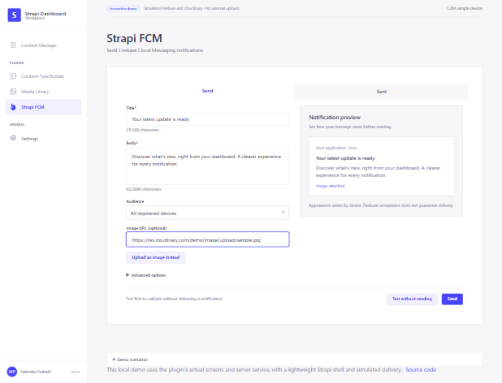
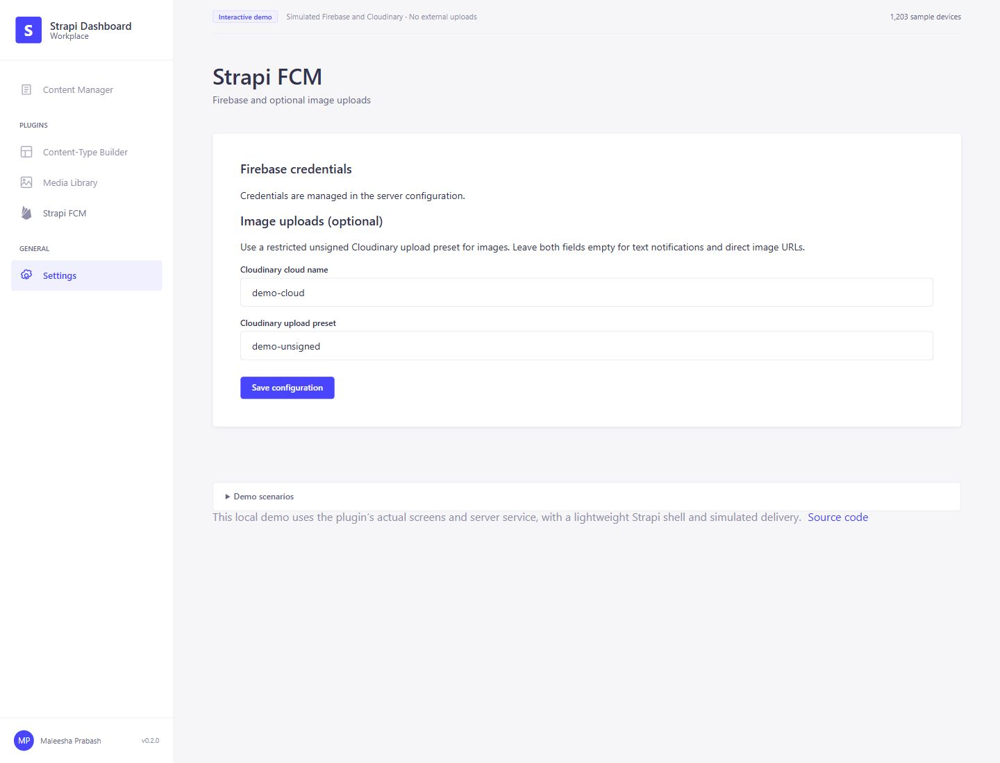
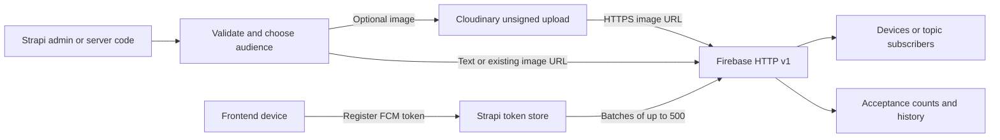
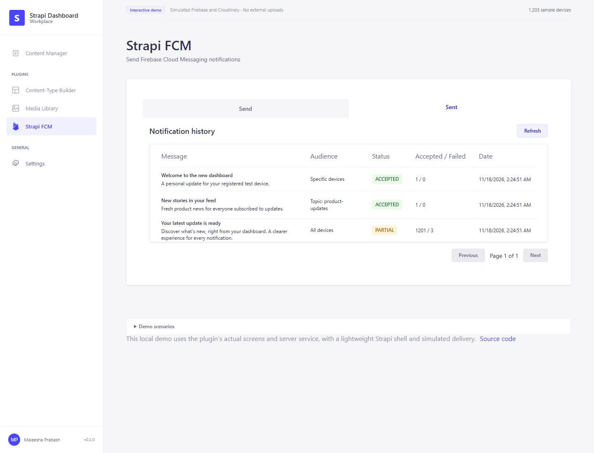
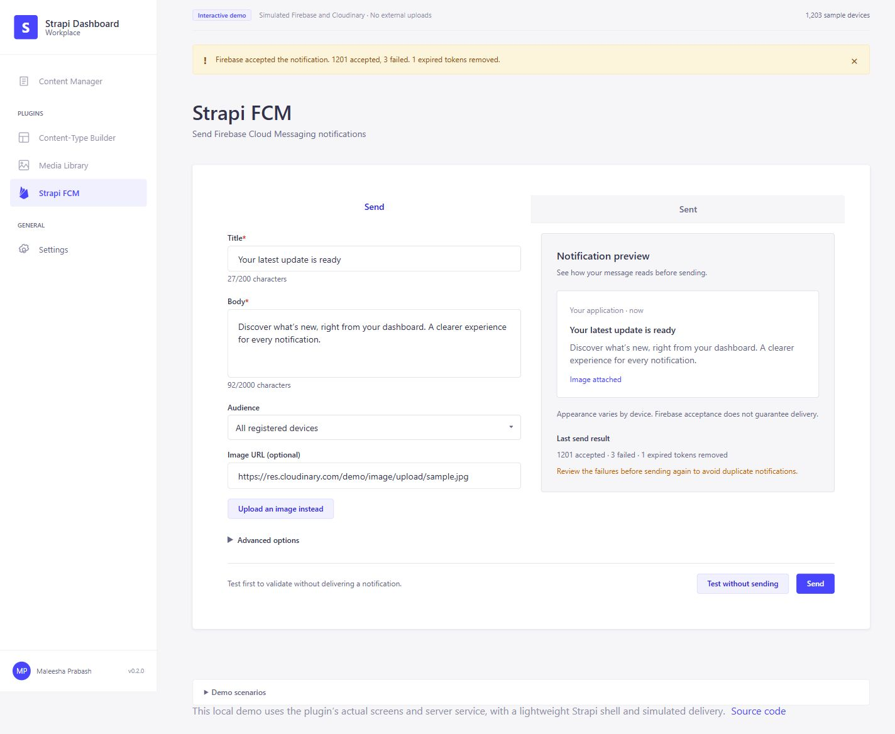
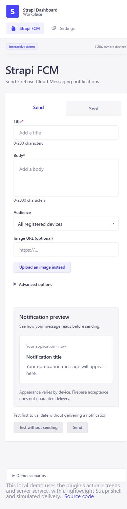

<p align="center">
  
</p>

<h1 align="center">Strapi FCM</h1>

<p align="center">Firebase push notifications, right inside your Strapi workflow.</p>

<p align="center">
  <a href="https://www.npmjs.com/package/strapi-fcm"></a>
  
  
  <a href="LICENSE"></a>
</p>

<p align="center">
  <a href="#get-started">Get started</a> ·
  <a href="#how-it-works">How it works</a> ·
  <a href="#screenshots">Screenshots</a> ·
  <a href="docs/api.md">API reference</a> ·
  <a href="docs/upgrade.md">Upgrade guide</a>
</p>

Compose a message, choose an audience, test it, and review the result. Strapi FCM keeps the familiar purple-and-gray Strapi interface while adding current Firebase sending APIs, optional Cloudinary images, and clear acceptance and failure counts.



## What you can do

| Capability | What it gives you |
| --- | --- |
| **Compose and preview** | Title, body, optional image, and a live text preview before sending. |
| **Choose your audience** | All registered devices, selected device tokens, or a Firebase topic. |
| **Test without delivery** | Firebase validation without sending, removing tokens, or creating history. |
| **Send at scale** | Registered devices are read in pages and sent in batches of up to 500. |
| **Review every send** | Paginated history with accepted, failed, partial, and empty-audience results. |
| **Keep tokens clean** | Duplicate-safe registration and removal of definitively expired tokens after real sends. |
| **Use Cloudinary images** | Optional PNG/JPEG uploads, HTTPS URLs, and actionable upload errors. |
| **Work from your content** | Send notifications from the content manager using selected text and image fields. |

## Requirements

| Component | Supported configuration |
| --- | --- |
| Strapi | **4.26.2** (Strapi 4; Strapi 5 is not supported) |
| Node.js | **22** |
| React | **18**, provided by your Strapi application |
| Firebase | A project with Cloud Messaging enabled and server credentials |
| Cloudinary | Optional; a cloud name and restricted **unsigned** upload preset |

**Upgrading from 0.1.x?** Read the [upgrade guide](docs/upgrade.md) before starting Strapi. This release changes runtime requirements, adds a unique-token constraint, and updates the history response format.

## Get started

### 1. Install the plugin

In your Strapi project:

```sh
npm install strapi-fcm@0.2.0
```

Enable it in `config/plugins.js` if it is not discovered automatically:

```js
module.exports = () => ({
  'strapi-fcm': { enabled: true },
});
```

Rebuild the admin panel and start Strapi:

```sh
npm run build
npm run develop
```

### 2. Connect Firebase

Open **Settings → Strapi FCM → Configure** and upload the service account JSON file from your Firebase project. For server-managed credentials or Google Application Default Credentials, follow the [configuration guide](docs/configuration.md).

Configuration responses never return your private key. The plugin uses its own named Firebase app so it can coexist with other Firebase integrations.

Assign the plugin's **Read**, **Send**, and **Configure** permissions to the appropriate Strapi admin roles. Read loads the plugin; Send permits notifications; Configure permits settings changes.

### 3. Add image uploads, if you need them

In Cloudinary, create an **unsigned image upload preset** restricted to the formats, size, and folder you need. Enter the **cloud name** and **preset name** in the plugin settings.

These fields are not a Cloudinary API key or API secret. Leave both blank for text notifications and direct HTTPS image URLs. You can select a PNG or JPEG up to **5 MB**; platform-specific Firebase image limits still apply.



Uploads use multipart form data, and only the image and unsigned preset go to Cloudinary. The returned HTTPS image URL is included in the Firebase notification. Upload failures stop the send and show a useful error. See [Cloudinary setup and behavior](docs/configuration.md#optional-cloudinary-images).

### 4. Register your frontend's devices

Obtain a registration token with the Firebase client SDK, then send it to the existing plugin endpoint:

```js
async function registerDevice(firebaseRegistrationToken) {
  const response = await fetch(
    'https://your-strapi.example/strapi-fcm/users/tokens',
    {
      method: 'POST',
      headers: { 'Content-Type': 'application/json' },
      body: JSON.stringify({ token: firebaseRegistrationToken }),
    }
  );

  if (!response.ok) throw new Error('Device registration failed');
  return response.json(); // { registered: true }
}
```

Configure Strapi CORS for your frontend. Registration is public, validated, rate-limited, and safe to repeat for the same token. Never send a Strapi admin bearer token to frontend users. For token acquisition, see [Firebase's web client setup](https://firebase.google.com/docs/cloud-messaging/js/client).

### 5. Test, send, and review

Open **Strapi FCM → Send**. Enter a title and body, then choose **All registered devices**, **Specific devices**, or **Firebase topic**. Images are optional; custom string data is available under **Advanced options**.

Use **Test without sending** to validate with Firebase first. A test does not deliver a notification, alter tokens, or create a history entry. For a test with an image, use an existing HTTPS image URL instead of uploading a new local file.

Choose **Send** when ready, then open **Sent** to inspect the result. Firebase acceptance is not proof that a device received or displayed a notification. Review partial or failed results before retrying to avoid duplicates.

## How it works



1. **Register:** your frontend submits device tokens; repeat registrations are deduplicated.
2. **Prepare:** an authorized admin or trusted server validates a message and chooses its audience. A selected image uploads to Cloudinary first.
3. **Send:** Firebase receives the notification through current Admin SDK APIs. Broadcasts use batches of up to 500 tokens.
4. **Review:** acceptance and failure counts are stored in history. Definitively expired tokens are removed after real sends; temporary failures leave tokens intact.

Topic counts represent one accepted topic request, not the number of subscribers. The plugin does not automatically retry broadcasts or promise exactly-once delivery.

## Screenshots

### Delivery history

See broadcast, topic, and selected-device sends in the same history, with readable status badges and acceptance counts.



<details>
<summary><strong>View a partial-delivery result</strong></summary>



</details>

<details>
<summary><strong>View the responsive mobile layout</strong></summary>



</details>

Screenshots use the actual plugin screens and the official Strapi design system inside the local demo. Firebase delivery and Cloudinary uploads are simulated; the images show sample data, not live delivery evidence.

## Send from server code

Use the service from trusted Strapi code, including your own controllers or lifecycle logic:

```js
const result = await strapi
  .plugin('strapi-fcm')
  .service('service')
  .sendNotification({
    title: 'A new update',
    body: 'Your dashboard is ready.',
    // Optional: omit tokens and topic to broadcast to registered devices.
    topic: 'product-updates',
    data: { screen: 'updates' },
    dryRun: false,
  });
```

Devices must already be subscribed to the topic. Use `tokens: ['registration-token']` instead of `topic` to target devices. See the [API reference](docs/api.md) for payload limits, response examples, history pagination, and admin routes.

## Try the local demo

Clone the repository and run:

```sh
npm ci
npm run demo:setup
npm run demo
```

Open **[http://127.0.0.1:4173](http://127.0.0.1:4173)**. The demo uses the plugin's real screens, server service, and official Strapi interface components. It simulates Firebase and Cloudinary against an in-memory database, so it sends no real notifications and uploads no files externally.

Open **Demo scenarios** to try healthy devices, an expired token, temporary failures, an empty audience, or a transport error. Demo settings and history reset when the process restarts. Without the optional `demo:setup`, lightweight visual adapters are used instead.

The demo is not a full Strapi installation. Live verification needs your Firebase test project and your actual Cloudinary cloud name and restricted unsigned preset.

## Development and upgrades

```sh
npm test
npm run check:admin
npm audit --omit=dev
npm pack --dry-run
```

The automated suite covers batch sending, selected audiences, token cleanup, credential rotation, error responses, rate limits, Cloudinary upload behavior, and upgrade preparation. [Verification details](docs/verification.md) explain what was tested and which checks require live accounts.

Before upgrading a 0.1.x database, follow the [upgrade guide](docs/upgrade.md). The preparation tool defaults to a read-only report; its explicit `--apply` mode cleans invalid and duplicate token rows before the new unique constraint is synchronized.

## Documentation

- [Firebase and Cloudinary configuration](docs/configuration.md)
- [Sending notifications and API reference](docs/api.md)
- [Upgrade from 0.1.x](docs/upgrade.md)
- [Verification notes](docs/verification.md)
- [Changelog](CHANGELOG.md)

MIT © Maleesha Prabash · [npm](https://www.npmjs.com/package/strapi-fcm) · [Source](https://github.com/klpmaleesha/strapi-fcm) · [Report an issue](https://github.com/klpmaleesha/strapi-fcm/issues)
